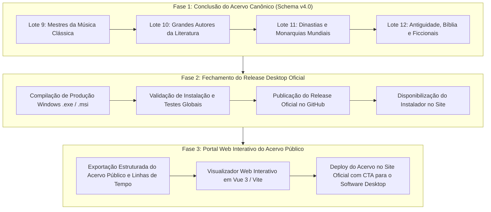

# ROADMAP ESTRATÉGICO: ELOTEMPO

Documento diretor de evolução do **EloTempo**, definindo as três grandes fases estratégicas de consolidação do acervo canônico, publicação da versão desktop oficial e disponibilização universal do acervo público no portal web.

---

## Visão Geral & Posicionamento do Produto

O **EloTempo** adota um modelo híbrido com distinção nítida entre o aplicativo desktop e o portal web:

1. **EloTempo Desktop (Software Local para PC)**:
   - **Público-alvo**: Usuários, famílias, genealogistas e historiadores que desejam pesquisar, criar e gerenciar suas próprias linhagens familiares e linhas do tempo pessoais.
   - **Diferencial**: 100% offline, privacidade absoluta, criptografia local AES-256-GCM / Argon2id, banco de dados SQLite local, importação e exportação de pacotes GEDCOM 7.0 / 5.5.1, alta performance nativa em Rust e Tauri.

2. **EloTempo Web (Portal do Acervo Público & Linhas de Contexto)**:
   - **Público-alvo**: Público geral, estudantes, pesquisadores e curiosos que desejam apenas consultar e explorar a história da humanidade e do Brasil.
   - **Diferencial**: Acesso instantâneo sem necessidade de download ou instalação, compatível com navegadores mobile e desktop, indexável por mecanismos de busca (SEO) e compartilhável via links diretos.

---

## Macrofases de Execução

---

## Fase 1: Conclusão do Acervo Canônico

Garantir que todas as **78 árvores genealógicas públicas** atinjam 100% de completude nos seguintes pilares:
- **Zero Falsos Positivos**: Retratos contemporâneos certificados ou preservação estrita dos avatares nativos de época do EloTempo por gênero e ano de nascimento.
- **Padrão Arquivístico Schema v4.0**: Metadados institucionais (`artwork`, `rights`, `provenance`) com espelho JSON para todas as imagens curadas.
- **Catálogo de Obras Capitais (`obras_culturais`)**: Inserção de tratados, partituras, literatura, ciência e ordens de estado.
- **Multilinguismo Integral (`idiomas_pessoa`)**: Cobertura de idiomas maternos e poliglóticos de todos os membros.
- **Georreferenciamento Preciso (`locais`)**: Migrações de novos locais históricos com coordenadas e índices semânticos.

### Lotes da Fase 1:
- [x] **Lote Brasil Ilustre** (8 árvores - Caxias, Nabuco, Machado, Oswaldo Cruz, Rio Branco, Ruy Barbosa, Santos Dumont, Mauá)
- [x] **Lote 5: Grandes Dinastias Políticas do Séc. XX** (Roosevelt, Kennedy, Bush, Churchill, Gandhi, Mandela, MLK, Stalin, Mao, etc.)
- [x] **Lote 6: Grandes Empreendedores & Pioneiros Industriais** (Matarazzo, Klabin, Guinle, Penteado, Silva Prado, Rockefeller)
- [x] **Lote 7: Pioneiros da Revolução Científica & Pensamento Moderno** (Einstein, Newton, Galileu, Da Vinci, Tesla, Edison, Curie, Darwin)
- [x] **Lote 8: Pais Fundadores & Estadistas das Américas** (Washington, Jefferson, Franklin, Lincoln, Protagonistas de 1822)
- [x] **Lote 9: Mestres da Música Clássica & Artes Cênicas** (Bach, Mozart, Beethoven, Chiquinha Gonzaga)
- [x] **Lote 10: Grandes Gênios da Literatura Universal & Dramaturgia** (Shakespeare, Cervantes, Dante, Goethe, Victor Hugo)
- [x] **Lote 11: Dinastias Imperiais e Monarquias Mundiais** (Habsburgo, Bourbon, Yamato, Casas Tradicionais)
- [x] **Lote 12: Antiguidade, Tradição Bíblica e Genealogias Ficcionais** (Egito 18ª/19ª/21ª-23ª, Confúcio, Lurie, Davi, Adão, Moisés, Patriarcas, Jesus Lucas/Mateus, Buendía, Compson, Corleone, Karamazov, Lannister, Skywalker, Targaryen, Terra Cambará) — **CONCLUÍDO (FASE 1 100% FINALIZADA)**

---

## Fase 2: Fechamento do Release Desktop Oficial [CONCLUÍDA]

- [x] **Geração do Executável e Instaladores de Produção (v1.1.0)**:
  - Compilação otimizada via Tauri CLI v2 (`npm run instalador`) com migrações 001 a 046 e sementes 0 a 27 embutidas.
  - Instalador Windows NSIS: `EloTempo_1.1.0_x64-setup.exe` (3,62 MB | SHA-256: `6b73cf5b6298d34435c78a279f7173d23cbdb893546b0138f2742823d1a5d676`).
  - Pacote Corporativo MSI: `EloTempo_1.1.0_x64_pt-BR.msi` (4,50 MB | SHA-256: `4de414538e87544d00eef2507bcc27c1fbf909cba6d7a96b92aa662bf29aa71e`).
  - Executável Independente: `elotempo.exe` (9,96 MB | SHA-256: `8381b194ed991e35a72a324175d362d5b8a3bc500816096f820b1d49e5e4caa7`).
- [x] **Homologação e Testes de Integridade**:
  - 258 testes em Rust (`cargo test`) e 171 testes no frontend (`vitest`) 100% aprovados.
  - Validação de cabeçalho PE x64 e integridade de inicialização com tempo de resposta instantâneo.
- [x] **Preparação dos Artefatos de Release**:
  - `RELEASE_NOTES_v1.1.0.md` gerado na raiz com changelog integral, metadados e requisitos.
  - Pronto para submissão no GitHub Releases e distribuição no site.

---

## Fase 3: Portal Web Interativo do Acervo Público [CONCLUÍDA]

- [x] **Pipeline de Exportação Automática (`scripts/exportar_acervo_web.py`)**:
  - Exportação estruturada das 78 árvores genealógicas públicas para arquivos JSON leves e otimizados (`elotempo-site/acervo/dados/`).
  - Otimização com Pillow dos 453 retratos públicos para a web (economia de 544 MB de largura de banda).
  - Exportação das 38 linhas de tempo de contexto e 433 marcos históricos universais.
- [x] **Portal Web Interativo (`elotempo-site/acervo/`)**:
  - Catálogo filtrável por 10 categorias temáticas com busca instantânea em tempo real.
  - Visualizador interativo de árvores genealógicas (*Tree Explorer*) com layout de gerações e nós familiares.
  - Modal de fichas biográficas completas com retratos em alta definição, minibiografias, catálogo de obras e idiomas.
  - Visualizador cronológico da Linha do Tempo Universal e marcos civilizacionais.
  - Banner estratégico de conversão com link direto para download do instalador oficial desktop v1.1.0.
- [x] **Integração na Landing Page Oficial (`elotempo-site/index.html`)**:
  - Link "Acervo Histórico" adicionado na barra de navegação superior.
  - Callout de destaque na seção Hero convidando a explorar o acervo web no navegador.
  - Atualização dos botões de download para a versão oficial v1.1.0.

